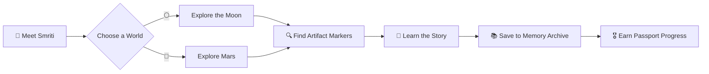

<div align="center">

# 🌌 CosmoSmriti — The Cosmos

### Exploring the Forgotten Memories of the Moon and Mars

**An Interactive 3D Space Museum** · NASA Space Apps Challenge 2026

<br/>

[](https://cosmosmriti-thecosmos.lovable.app/)
[](https://github.com/mohimaazad5321-pixel/cosmosmriti-thecosmos)
[](https://www.spaceappschallenge.org/)


> **"The universe never forgets."**
> *Every abandoned object has a story. Every forgotten machine holds a memory.*

</div>

---

## 📖 Table of Contents

- [About](#-about-the-project)
- [Vision](#-our-vision--explore-through-a-robots-eyes)
- [Features](#-key-features)
- [The Problem & Our Solution](#-the-problem--our-solution)
- [How It Works](#-how-it-works)
- [Tech Stack](#️-technology-stack)
- [NASA Data & References](#-nasa-data--scientific-references)
- [Getting Started](#️-getting-started)
- [Project Structure](#-project-structure)
- [Demo](#-project-demonstration)
- [Team](#-our-team)
- [Use of AI](#-use-of-artificial-intelligence)
- [Acknowledgements](#-acknowledgements)

---

## ✨ About the Project

**What if the abandoned machines on the Moon and Mars could tell their stories?**

Every space mission leaves behind more than scientific achievements. It leaves equipment, instruments, and pieces of human history scattered across extraterrestrial landscapes.

**CosmoSmriti** is an interactive, educational 3D space museum that brings these forgotten stories back to life. It was created for NASA's challenge *"Abandoned but Not Forgotten: Storytelling about NASA's Discarded Equipment on the Moon and Mars."*

> 🪔 **About the name:** *Smriti* (স্মৃতি) means **"memory"** in Bengali. CosmoSmriti is, quite literally, the *memory of the cosmos*.

Instead of reading another history page, visitors **explore the Moon and Mars, discover forgotten artifacts, and uncover the stories behind them.**

**Our mission:** *No space exploration story deserves to be forgotten.*

---

## 💡 Our Vision — Explore Through a Robot's Eyes

The journey begins with **Smriti**, our robotic *Cosmic Memory Keeper*. Smriti has two curious eyes, each one a world:

| 👁️ Left Eye | 👁️ Right Eye |
|:---:|:---:|
| 🌕 **The Moon** | 🔴 **Mars** |

Visitors choose a world and walk through its landscape. Along the way they find **discovery points**, each one a piece of historical equipment with its own purpose, history, scientific importance, and current condition.

We want visitors to feel like **explorers uncovering memories**, not students memorizing facts.

---

## 🚀 Key Features

| | Feature | Description |
|:-:|---|---|
| 🌕 | **Moon Exploration** | A digitally recreated lunar environment with historical equipment left by human missions. |
| 🔴 | **Mars Exploration** | A Martian-inspired landscape telling the stories of robotic exploration. |
| 🤖 | **Smriti, the Memory Keeper** | A robot-inspired guide who introduces the experience and embodies the memories of both worlds. |
| 🔍 | **Artifact Discovery** | Discovery markers open detailed information panels and storytelling for each object. |
| 🏛️ | **Interactive Space Museum** | Exploration history turned into an educational, explorable experience. |
| ⏳ | **Mission Time Machine** | Revisit important moments in mission history in context. |
| 📚 | **Memory Archive** | A dedicated space to revisit every cosmic memory you've discovered. |
| 🎖️ | **Cosmic Passport** | Tracks your discoveries and progress as an explorer. |
| 🧩 | **Challenges & Learning** | Interactive challenges that make learning fun. |

> ℹ️ *Available sections and final functionality may evolve as development continues.*

---

## 🎯 The Problem & Our Solution

### The Problem

Many people know about the Apollo missions and Mars rovers, but far fewer can answer:

- What equipment was left behind?
- Why was it important?
- What scientific purpose did it serve?
- Where is it located today?
- What does it tell us about humanity's exploration of space?

Traditional educational resources make this hard to explore interactively.

### Our Solution

CosmoSmriti closes this gap by combining:

- 🌐 Digital extraterrestrial environments
- 🛰️ Historical space artifact information
- 🧭 Interactive discovery experiences
- 📜 Mission-based storytelling
- 🎓 Educational content for students and space enthusiasts

---

## 🧠 How It Works



1. **Enter the Experience:** Meet Smriti, the Cosmic Memory Keeper.
2. **Choose a World:** Select the Moon or Mars.
3. **Explore:** Navigate the digital extraterrestrial environment.
4. **Discover:** Find historical artifact markers.
5. **Learn:** Read the story and scientific significance of each object.
6. **Continue:** Revisit discoveries and explore more educational sections.

---

## 🛰️ Technology Stack

| Technology | Purpose |
|---|---|
| **React 19** | User interface |
| **TypeScript** | Type-safe development |
| **Vite** | Development and build tooling |
| **Three.js** | 3D graphics |
| **React Three Fiber** | 3D rendering with React |
| **Drei** | Three.js utilities |
| **Tailwind CSS** | Styling |
| **TanStack Start** | Application framework and routing |
| **Lovable** | AI-assisted development |

---

## 🪐 NASA Data & Scientific References

Scientific accuracy matters to us. CosmoSmriti is inspired by NASA's historical missions, records, imagery, and educational resources.

### 📡 Data Sources Used

| Source | What we use it for |
|---|---|
| 🗺️ [**NASA Solar System Treks**](https://trek.nasa.gov/) | Moon Trek and Mars Trek WMTS tiles for the basemap (no authentication required) |
| 🔭 [**api.nasa.gov**](https://api.nasa.gov/) | Mars Rover Photos for rover imagery, and APOD (Astronomy Picture of the Day) for hero images |
| 🗄️ [**PDS Search API**](https://pds.nasa.gov/) and [**NSSDCA**](https://nssdc.gsfc.nasa.gov/) | Mission and spacecraft metadata with stable identifiers |
| 📄 [**NTRS**](https://ntrs.nasa.gov/) (NASA Technical Reports Server) | Mission reports for dates and the science each object enabled |

### 🔗 More Official Resources

- 🚀 [NASA](https://www.nasa.gov/)
- 🖼️ [NASA Image and Video Library](https://images.nasa.gov/)
- 🔴 [NASA Mars Exploration](https://science.nasa.gov/mars/)
- 🌕 [NASA Moon Exploration](https://science.nasa.gov/moon/)

> ⚠️ **Please note:** We distinguish official NASA information from project-created interpretations. Illustrative locations and reconstructed 3D models are **not** exact physical representations. Specific images, datasets, and mission records are credited individually with their original source links.

---

## 🛠️ Getting Started

### Prerequisites

- [Node.js](https://nodejs.org/)
- [Bun](https://bun.sh/) (recommended)

### Installation

```bash
# 1. Clone the repository
git clone https://github.com/mohimaazad5321-pixel/cosmosmriti-thecosmos.git

# 2. Enter the project directory
cd cosmosmriti-thecosmos

# 3. Install dependencies
bun install

# 4. Start the development server
bun run dev
```

Then open the local URL shown in your terminal. 🎉

<details>
<summary><b>📜 Available Scripts</b></summary>

| Command | What it does |
|---|---|
| `bun run dev` | Start the development server |
| `bun run build` | Create a production build |
| `bun run preview` | Preview the production build |
| `bun run lint` | Run the linter |
| `bun run test` | Run tests |

</details>

---

## 📁 Project Structure

<details>
<summary><b>Click to expand</b></summary>

```text
cosmosmriti-thecosmos/
├── public/            # Static assets
├── src/
│   ├── assets/        # Images, textures, models
│   ├── components/    # Reusable UI components
│   ├── data/          # Artifact & mission content
│   ├── game/          # Exploration & challenge logic
│   ├── hooks/         # Custom React hooks
│   ├── lib/           # Utilities
│   ├── routes/        # Pages and routing
│   ├── test/          # Tests
│   ├── types/         # TypeScript types
│   ├── router.tsx
│   ├── server.ts
│   └── start.ts
├── package.json
├── bun.lock
├── tsconfig.json
├── vite.config.ts
└── README.md
```

</details>

---

## 🎬 Project Demonstration

| 🎥 Video | Link |
|---|---|
| **Project Presentation** (240 second] https://youtu.be/NBkGACdYyjQ?si=GoRPalokS_9b1CjY
| **Short Project Demo** (30 seconds) | https://youtu.be/OASq343Go80?si=s2oqBzI2TUWG9Yya

---

## 👥 Our Team

**Team COSMOS** · NASA Space Apps Challenge 2026

| Member | Role / Contribution |
|---|---|
Mohema akter - Team Lead,Video Editor
Mahin Hossain- Designer
Mahfuz Khan- Developer
Afsana Sabia- Data Scientist
Rakib Islam- Researcher
Debobrata Roy- Presenter

---

## 🤖 Use of Artificial Intelligence

We used **Lovable**, an AI-assisted development tool, to accelerate implementation through code generation and development workflows.

The project concept, experience design, feature requirements, content decisions, and testing came from our team. AI was a development tool, **not a substitute for scientific verification**, and historical and scientific claims were checked against official NASA references.

---

## 🙏 Acknowledgements

- **NASA** and its partner organizations for making space exploration information and educational resources accessible.
- The **NASA Space Apps Challenge** community for inspiring creative approaches to real-world problems.
- The **open-source community** for the technologies that power this project.

---

<div align="center">

### 🌌 CosmoSmriti — The Cosmos

**The universe never forgets.**

*Every abandoned object has a story. Every forgotten machine holds a memory.*

**Let's rediscover them. 🚀**

⭐ *If you enjoyed exploring, consider starring the repo!* ⭐

</div>
